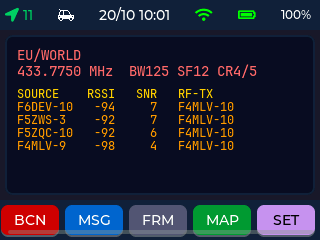
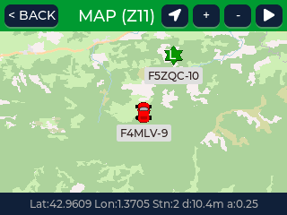
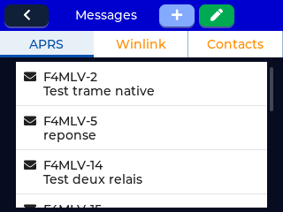
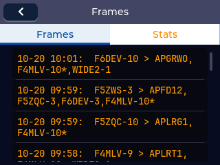

# LoRa APRS Tracker - LVGL UI Edition

**ESP32-S3 LoRa APRS tracker with modern touchscreen interface for Lilygo T-Deck Plus and CrowPanel Advance 3.5", plus classic OLED tracker for T-Beam V1.2**

This is a fork of [CA2RXU's LoRa APRS Tracker](https://github.com/richonguzman/LoRa_APRS_Tracker) featuring a complete LVGL-based touchscreen interface with vector map rendering (NAV format compatible with [IceNav-v3](https://github.com/jgauchia/IceNav-v3)), LovyanGFX graphics library for enhanced performance, advanced APRS messaging, and optimized memory management.

## Screenshots

|||||
|:-:|:-:|:-:|:-:|
| **Dashboard** | **Vector Map** | **Messaging** | **Frames** |

> *Screenshots taken on a T-Deck Plus.*

---
## What's New in v2.11.3
- **Readable "no map" message** - Without maps on the SD card, the map screen drew its message mostly off the left edge of the screen. It is now centred and gives both paths: `/LoRa_Tracker/VectMaps/REGION/` for vector maps and `/LoRa_Tracker/Maps/REGION/z/x/y.png` for raster tiles.
- **Wiki link** - The web flasher pages now link the user guide.

## What's New in v2.11.2
- **Unlock reminder** - On the locked T-Deck, a touch or any key lights the screen for 3 seconds with "Screen locked / Press Q then Space", then turns it off again. Before, the screen stayed black and ignored every input, so the lock looked like a freeze.

## What's New in v2.11.1
- **Trackball on the locked T-Deck** - Double and multiple trackball clicks no longer turn on the backlight of the locked screen, which left a lit but unresponsive display.

---
## What's New in v2.11.0
- **Batch message deletion** - Long press a message in a conversation to enter selection mode, select as many as needed, and the reply button becomes a trash button that deletes them in one pass.
- **Faster conversation list** - Listing conversations opened every file just to read its name and date. It now reads the directory directly: 7.3 s for 192 conversations before the change, measured on a user's device. Thanks to @n7uv for the logs.
- **Larger touch targets** - Title bar buttons (back, reply) were 25-28 px high in a 35 px bar, so taps on the last pixels of the bar hit nothing. Their sensitive area is extended without changing their look.
- **WiFi after switching networks** - Forcing public DNS servers also froze the IP address, so the tracker kept the address of the previous network after switching access points without a reboot. DHCP now stays active.
- **WiFi status** - The WiFi screen and APRS-IS uploads follow the real link state instead of a flag that stayed true for 30 s after the access point disappeared.
- **APRS reply-acks** - Outgoing messages use reply-ack numbers (`{MM}AA`), and an acknowledgement carried by an incoming message stops the retries.
- **BLE TNC2** - TNC2 frames are queued and sent over the standard Nordic UART Service.
- **Mic-E** - Encoding follows the active beacon profile, and decoded longitude offsets are normalized.
- **T-Deck SD card** - Accesses to the SD card, which shares its SPI bus with the LoRa radio and the display, are serialized.
- **T-Deck screen lock** - When ECO Mode turns the screen off, touch and keyboard are ignored until **Q** then **Space** are pressed within one second, so the device cannot wake up by accident in a pocket.
- **Quieter GPS log** - The "poor signal freeze" message is logged when the state changes, not once per second.
- **Idle power saving** - With the screen off, WiFi and BLE off and on battery, the main loop slows from about 880 to 16 iterations per second, letting the CPU sleep between ticks. LoRa reception, beacons and GPX recording are unaffected.
- **Log over HTTP** - `http://<tracker>/log` serves the SD card journal, `?grep=TEXT` filters it.

**In the devel build only:**
- **Native LoRa APRS frames** - Reception and optional transmission of the compact native format, selected by `loraConfig.txFormat`.

---
## What's New in v2.10.2
- **Much faster message navigation** - Building the conversation list re-read every conversation file in full, just to show the last line of each. With hundreds of correspondents this took close to a minute per screen change. Previews are now cached in PSRAM and validated by file mtime: an unchanged conversation is not read at all, and a changed one only has its last 256 bytes read. Thanks to @n7uv for the report.

---
## What's New in v2.10.1
- **Raster PNG tiles fixed** - PNG map tiles never rendered and every attempt permanently leaked an SD file descriptor, which eventually broke *all* SD access for the rest of the session (logs, statistics, GPX, station symbols). `renderPNGRaster()` was checking PNGdec's return value with JPEGDEC's convention — the two are opposite (`PNG_SUCCESS` is `0`). The same close-on-failure leak is fixed in the JPEG and symbol paths. Thanks to @cwb for the diagnosis and the fix (#2, #3).

---
## What's New in v2.10.0
- **Direct vs digipeated, everywhere** - The dashboard Last RX list is colour-coded again (green = heard directly, orange = via a digipeater), matching the Frames screen. The distinction had been lost when the dashboard moved to its RAM cache.
- **RF neighbourhood statistics** - Per-station RSSI/SNR averages are now computed from direct receptions only. On a digipeated frame those figures describe the digipeater, not the originating station, so a distant station used to inherit its relay's signal level. Stations never heard directly show `--` instead of a misleading value, and the 20-slot table evicts them before dropping a direct neighbour.
- **Delete APRS conversations** - Long press on a conversation to delete it.
- **Tracker WebConf SPA** - Web configuration is now organized as a sidebar/topbar SPA with Tracker-specific fields and visual identity, with a mobile layout so the whole configuration can be done from a phone.
- **LoRa profiles** - WebConf and LVGL settings share configurable LoRa profiles, including the default EU/WORLD, Poland, and UK profiles.
- **WiFi STA profiles** - Station WiFi settings support a multi-profile list instead of a single fixed configuration.
- **Messaging unread state** - APRS and Winlink unread counters are persisted, conversations with new messages are highlighted, and recent conversations move to the top when new traffic arrives.
- **Frames screen** - Frames and statistics are now opened from a dedicated dashboard button, leaving the Messages tabs focused on APRS, Winlink, and Contacts.
- **Stable web flasher** - T-Deck Plus 433MHz and CrowPanel Advance 3.5" stable builds are published as v2.10.0.

## What's New in v2.9.5
- **Digipeater fill-in mode** - New `digipeatAlias` setting (default `WIDE1-1`), separate from the beacon path, with a selector in the Repeater screen. The tracker relays stations not yet repeated by any digi, consuming `WIDE1-1` while preserving `WIDE2-1` for the next hop — useful to form a local tracker network when no digi/igate is in range
- **Digipeat safety guards** - Self-echo protection (never repeat our own beacon sent back by a neighbour) and refusal to repeat when the alias is already consumed (`ALIAS*`), which previously produced malformed `CALL**` paths
- **MAX17048 fuel gauge on CrowPanel** - Read through the LovyanGFX I2C driver, fixing the conflict with the GT911 touch controller sharing the same bus (battery monitoring was reported as "not found")
- **Touch wake-up fix** - The touch that wakes the screen from eco mode is now absorbed and no longer triggers the button underneath
- **Map station tap fix** - Station hit zones are converted to the live canvas position (pan and NAV sub-tile offsets), making taps reliable at any map offset

## What's New in v2.9.4
- **Web Flasher Multi-Board** - Single-page web installer with board selector: T-Deck Plus 433, CrowPanel 3.5", T-Beam V1.2
- **T-Beam V1.2 support** - Classic OLED tracker firmware with GNSS quality filtering and SmartBeacon advanced web config
- **Strict 3D Fix (PDOP)** - New configurable mode to enforce PDOP filtering for altitude reliability, with a visual indicator on the dashboard.
- **Persistent Map State** - Map's NAV memory pool and zoom/pan state are preserved across sessions to avoid PSRAM fragmentation and improve user experience.
- **NeoGPS migration** - Replaced TinyGPS++ (legacy 2013) with NeoGPS: coherent fix merging, HDOP from GGA, configurable sentence parsing
- **GPS Doppler cross-check filter** - New jitter rejection: when GPS reports low speed (< 8 km/h) but position barely moved (< 25m), the update is rejected. Fixes L76K Doppler noise at rest
- **HDOP quality indicator** - Satellite count on dashboard shows signal quality: `+` (≤ 2.0), `-` (2-5), `X` (> 5)
- **Trace z-order fix** - GPS traces now render under station icons
- **Map module refactoring** - `ui_map_manager.cpp` split into `map_state`, `map_tiles`, `map_render`, `map_input` modules (2247 → 655 lines)
- **PSRAM cache for GPS traces** - SD trace files are loaded into PSRAM at startup; viewport queries scan RAM instead of SD card, drastically improving map rendering performance
- **SmartBeacon-like trace compaction** - Replaced recursive Douglas-Peucker algorithm with speed/distance criteria similar to SmartBeacon for more natural trail preservation
- **mass_copy utility** - Python script for efficient bulk copying of map tiles to SD card (from IceNav-v3)

## What's New in v2.8.x
- **IceNav pan model** - Ported IceNav integer tile pan model: smooth inertia, no visual snap during async render, decoupled visual offset from render cycle
- **Async rendering Core 0** - Map tiles rendered on Core 0, UI runs on Core 1 without blocking. Double-buffered sprites for tear-free display
- **Fullscreen map** - Double-tap toggles fullscreen mode (hides title/info bars)
- **MapGPSFilter module** - GPS filtering as standalone KISS module with unit tests (GoogleTest)
- **Reliable GPS tracking** - HDOP-adaptive smoothing, stable at rest, responsive at speed, no km-scale jumps
- **Own GPS trace** - 500-point buffer with Douglas-Peucker auto-compaction and zoom-adaptive LOD rendering
- **SD logger** - GPS wall-clock timestamps, ESP_LOGW/E hook captures crash context automatically
- **+32KB DRAM recovered** - Removed useless DMA buffer in storage (PSRAM incompatible with SPI DMA on ESP32-S3)

## What's New in v2.7.x
- **ESP_LOG migration** - Replaced standard Serial.print with native ESP-IDF logging framework with colored terminal output
- **PSRAM LVGL Allocator** - Redirected UI memory to PSRAM to free up critical DRAM
- **NPK2 Multi-region support** - Support for "split packs" NPK2 map files with multi-region roaming
- **Wide Zoom Range** - Map support from Zoom 6 up to 17 with adaptive raster/vector switching
- **Vector map optimizations** - Increased NPK2 row buffer to 8KB in PSRAM for processing complex tiles
- **Web-Conf Stability** - Hardened against memory fragmentation and CPU starvation in configuration mode
- **GPX trace recorder** - Start/Stop button on map, saves tracks to SD card
- **Delta+ZigZag+VarInt NAV format** - 30-50% smaller tiles, compatible with IceNav-v3
- **Robust GPS filtering** - Advanced HDOP adaptive jitter filtering to prevent fake beacons and map spikes
- **NAV raw data cache** - PSRAM cache avoids SD re-reads after pan (30 tiles LRU)
- **Station traces with TTL** - 60-minute time-to-live for received station positions
- **Vector map rendering** - NAV format tiles with roads, paths, water bodies, buildings
- **Dual map modes** - Raster (JPEG/PNG) and Vector (NAV) with adaptive zoom
- **Statistics persistence** - LinkStats and per-station data saved to SD card
- **WiFi Station mode** - Connect to existing networks for internet access
- **APRS-IS Stability** - Extended logresp timeout to 10s with better connection cleanup
- **Display ECO slider** - Configurable timeout for screen dimming
- **Memory optimizations** - Fixed leaks, improved PSRAM usage
- **Stability and UI fixes** - BLE wake crash, SD logger infinite loop, dynamic callsign background width calculation

## Key Features

### Interface
- Full-color touchscreen UI (320x240) with LVGL 8.4
- **LovyanGFX** graphics library (replaces TFT_eSPI for better performance)
- Dashboard with real-time GPS, LoRa, WiFi, battery status
- Interactive map with dual rendering (raster/vector)
- APRS messaging with conversation view
- Touch-friendly configuration screens
- Physical QWERTY keyboard support

### Map System
- **Raster mode**: JPEG/PNG tiles (OpenStreetMap format)
  - Zoom levels: 8, 10, 12, 14, 16, 18 (step 2)
- **Vector mode**: NAV binary format (IceNav-v3 compatible)
  - Zoom levels: 8 to 18 (step 1)
  - Sub-pixel precision rendering
  - Dynamic background color from tiles
- APRS station display with symbols (primary/alternate tables)
- Label rendering with anti-collision detection
- GPS tracking with auto-follow and manual pan

### APRS & Messaging
- Full LoRa APRS support (433MHz)
- Threaded message conversations
- Contact management (add/edit/delete)
- Quick reply from map or station list
- Message history on SD card
- LinkStats and per-station statistics (max 20 stations)

### Hardware
- **LVGL Boards (touchscreen)**: Lilygo T-Deck Plus 433MHz (ESP32-S3) · CrowPanel Advance 3.5" (ESP32-S3)
- **OLED Board (classic)**: Lilygo T-Beam V1.2 433MHz (ESP32)
- **Display (LVGL boards)**: 320x240 or 480x320 IPS touchscreen with brightness control
- **LoRa**: SX1262 module
- **GPS**: Internal GPS module
- **Storage**: SD card (A1 class recommended for fast tile loading)
- **Connectivity**: WiFi (AP + Station modes), Bluetooth LE

## Documentation & User Guide

**All instructions for installation, configuration, and usage can be found on the Wiki:**

📖 [**Read the Wiki / User Guide**](https://github.com/moricef/LoRa_APRS_Tracker/wiki)

You will find details about:
- Installation and first boot (Web Flasher / PlatformIO)
- SD card preparation and raster/vector map tiles
- Messaging and UI operation
- Advanced settings

## Technical Details

**Memory**: ~88KB DRAM free during operation, PSRAM for tile/symbol cache and sprites

**Optimizations**:
- **PSRAM Asset Management**: UI allocator and tile/symbol cache redirected to PSRAM
- Synchronous tile rendering (decode + copy + cache)
- RGB565 byte-swap for correct LVGL colors
- Persistent viewport sprite (no fragmentation)
- LRU cache for raster and vector tiles
- Negative cache to avoid repeated SD scans

**Power Management**:
- Display: configurable ECO timeout
- T-Deck screen lock: when ECO Mode turns the screen off, touch and keyboard are ignored until **Q** then **Space** are pressed within one second
- WiFi: periodic sleep
- BLE: auto-disable after 5 min
- GPS: sleep between beacons

## Credits

**Original firmware**: [CA2RXU - Ricardo](https://github.com/richonguzman/LoRa_APRS_Tracker)

**Libraries & inspiration**:
- [LVGL](https://lvgl.io/) - UI library
- [LovyanGFX](https://github.com/lovyan03/LovyanGFX) - Graphics library
- [IceNav-v3](https://github.com/jgauchia/IceNav-v3) - NAV format and vector rendering

**Map data**: © [OpenStreetMap contributors](https://www.openstreetmap.org/copyright)

**LVGL UI development**: F4MLV

## Support This Project

If you find this project useful, please **star ⭐ the repo**!

[PayPal donation](https://paypal.me/moricef09) | [GitHub Sponsors](https://github.com/sponsors/moricef)

**Original project**: Support [CA2RXU](https://github.com/sponsors/richonguzman) too!

## License

Same license as original CA2RXU LoRa APRS Tracker.

## Issues & Support

**LVGL UI issues**: [Open issue on this fork](https://github.com/moricef/LoRa_APRS_Tracker/issues)

**General tracker issues**: See [original project](https://github.com/richonguzman/LoRa_APRS_Tracker)

---

73! F4MLV
